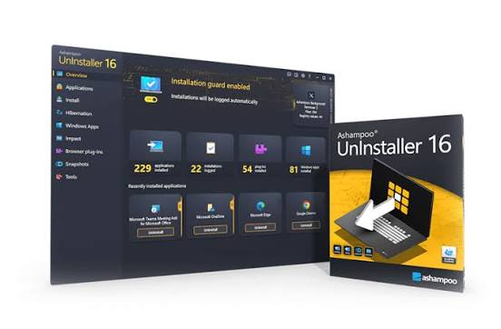
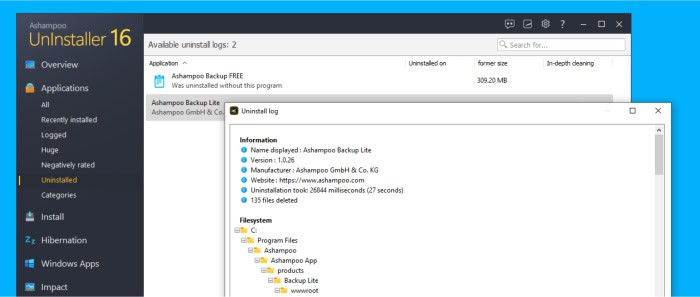

# Ashampoo UnInstaller for Reviewing Windows Software Removal

[](https://ashampoo-magical-portable.github.io/Ashampoo-Uninstaller/)

Ashampoo Uninstaller helps Windows users review installed software, monitor installations, and remove unwanted applications.
This guide focuses on identifying the right program, understanding removal stages, and checking the result.

Ashampoo Magical Uninstall is a search phrase used for this documentation project.
The commercial product discussed here is Ashampoo UnInstaller.

The accompanying files are a partial UniGetUI reference snapshot.
They illustrate a separate open-source package-management project and are not Ashampoo source code.

## Features

The Pro 27 manual describes installation monitoring, installation logs, snapshots, and in-depth cleaning.
These features provide different kinds of evidence about an application's changes.

| Evidence or operation | What it helps establish | Review point |
| --- | --- | --- |
| Installed-program entry | The listed name, publisher, and version | Confirm the intended application |
| Installation log | Changes associated with a monitored installation | Inspect the recorded paths |
| Snapshot comparison | Differences between two system states | Consider other activity during the interval |
| Standard uninstall routine | The application's own removal process | Read prompts and completion status |
| In-depth cleaning | Additional items proposed after removal | Review association with the selected application |

A recognizable publisher and version help distinguish similar entries.
Keep shared components separate from the application you intend to remove.

Software maintenance also includes checking whether an update would solve the original problem.
Avoid treating every outdated program as a removal candidate.

The UniGetUI test feed [productinfo.unigetui.test.json](testing/productinfo.unigetui.test.json) contains sample product metadata.
It is test data for that project, not an Ashampoo update catalog.

## Using it

Start with a clear reason for removing the application.
Record the problem, the installed version, and any data that should remain available.

A practical review sequence is:

1. Identify the program by name, publisher, and version.
2. Check whether it has an installation log.
3. Close the application and save open work.
4. Review the selected removal options.
5. Follow the application's uninstall prompts.
6. Inspect any additional cleaning proposal.
7. Confirm the final state after any requested restart.

Removing an entry from an installed-program list is different from uninstalling its application.
The Pro 27 manual documents an entry-deletion action separately from program removal.



The following Windows PowerShell example reads common uninstall registry locations.
It creates a desktop-program inventory without invoking any uninstall command.

```powershell
$keys = @(
    'HKLM:\Software\Microsoft\Windows\CurrentVersion\Uninstall\*'
    'HKLM:\Software\WOW6432Node\Microsoft\Windows\CurrentVersion\Uninstall\*'
    'HKCU:\Software\Microsoft\Windows\CurrentVersion\Uninstall\*'
)
Get-ItemProperty -Path $keys -ErrorAction SilentlyContinue |
    Where-Object { $_.DisplayName } |
    Select-Object DisplayName, DisplayVersion, Publisher |
    Sort-Object DisplayName
```

Use a 64-bit PowerShell session on 64-bit Windows for this view.
The output is not a complete inventory of Store apps or every user's software.

Compare the selected entry with the application shown in UnInstaller.
A missing registry entry alone does not prove that all associated files were removed.

## Package Managers

A package manager and a general-purpose uninstaller can represent applications differently.
Record the package source when investigating a program installed through a package manager.

The UniGetUI packaging references illustrate this distinction:

- [unigetui.template.nuspec](package/chocolatey/unigetui/unigetui.template.nuspec) defines Chocolatey package metadata.
- [chocolateyInstall.template.ps1](package/chocolatey/unigetui/tools/chocolateyInstall.template.ps1) supplies the package installation template.
- [chocolateyUninstall.ps1](package/chocolatey/unigetui/tools/chocolateyUninstall.ps1) handles that package's removal.
- [deploy.template.bat](package/chocolatey/unigetui/deploy.template.bat) supplies a package-publication command template.

The package removal script checks the number of matching uninstall entries.
Its handling of ambiguous matches is a useful reference for understanding application identity.

These scripts operate on UniGetUI packaging.
Their switches and commands are not an Ashampoo UnInstaller interface.

## Under the hood

Keep the commercial product's behavior separate from the reference project's implementation.
The available files explain packaging and testing rather than Ashampoo's detection algorithms.

The UniGetUI installer definition is [UniGetUI.iss](UniGetUI.iss).
Its development SDK selection appears in [global.json](global.json).

Three configuration documents describe different UniGetUI environments:

- [unigetui-min.winget](configuration.winget/unigetui-min.winget) lists a minimal runtime environment.
- [unigetui-all.winget](configuration.winget/unigetui-all.winget) lists a broader environment.
- [develop-unigetui.winget](configuration.winget/develop-unigetui.winget) describes development dependencies.

These documents can install software when applied by their associated tooling.
They are reference material here and do not configure Ashampoo.

The automation entry point [run-cli-e2e.ps1](testing/automation/run-cli-e2e.ps1) reads platform-specific test manifests.
The Windows definition is [cli-e2e.manifest.windows.json](testing/automation/cli-e2e.manifest.windows.json).

This Python example inspects that JSON using the standard library.
It prints test metadata without starting a daemon or running package operations.

```python
import json
from pathlib import Path

path = Path("testing/automation/cli-e2e.manifest.windows.json")
manifest = json.loads(path.read_text(encoding="utf-8-sig"))
print("Suite:", manifest["name"])
print("Transport:", manifest["transport"]["kind"])
print("Package managers:", len(manifest.get("packageManagers", [])))
```

The relative path assumes the reference snapshot is the working directory.
This inspection is unrelated to a native Ashampoo CLI.

Other automation references cover distinct environments and checks:

- [cli-e2e.manifest.linux.json](testing/automation/cli-e2e.manifest.linux.json) describes the Linux test variant.
- [cli-e2e.manifest.linux-nativeaot.json](testing/automation/cli-e2e.manifest.linux-nativeaot.json) selects a native daemon variant.
- [run-installer-path-tests.ps1](testing/automation/run-installer-path-tests.ps1) tests installer path handling with an isolated harness.
- [Assert-UniGetUIVisible.ps1](testing/desktop-smoke/Assert-UniGetUIVisible.ps1) checks desktop-window visibility.

A visible application window and a successful package operation are different test outcomes.
Neither alone establishes that a third-party application left no residual data.

## System Requirements

Ashampoo lists Windows 10 and Windows 11 for UnInstaller Pro 27.
Systems with ARM processors are not supported.

Full administrative rights are required.
An internet connection is required for activation and recurring license verification.

The SDK and Linux test files above belong to UniGetUI.
They do not define Ashampoo platform support or development requirements.

## Frequently asked questions

**Does an installation log replace a backup?**

Keep important application data independently backed up.
A record of installation changes does not serve the same purpose as a copy of your documents.

**How should snapshot differences be interpreted?**

Changes made by other applications can occur during the same interval.
Use the timing and affected paths when deciding whether a difference belongs to the reviewed installation.

**Does the phrase ashampoo uninstaller portable confirm an official portable edition?**

No. Verify the available distribution formats with Ashampoo before relying on that search phrase.
This repository does not provide a portable build of the commercial application.

**Which release does this guide describe?**

Current product references concern ashampoo uninstaller pro 27.
Check release-specific documentation when researching another ashampoo uninstaller pro version.



**Where can product behavior be checked?**

Use the [official product page](https://www.ashampoo.com/en-us/uninstaller), [Pro 27 manual](https://support.ashampoo.com/hc/en-us/articles/38705366838418-UnInstaller-Pro-27-Manual), and [system requirements](https://www.ashampoo.com/en-us/uninstaller/requirements).
The partial reference snapshot does not contain an Ashampoo build or SDK.

## Related Search Terms

Ashampoo Magical Uninstall, Ashampoo Uninstaller, ashampoo uninstaller pro, ashampoo uninstaller portable, ashampoo uninstaller pro 27, application-uninstaller, uninstaller, uninstall, bulk-uninstall, software-management, application-manager, windows, windows-10, windows-11, package-manager
